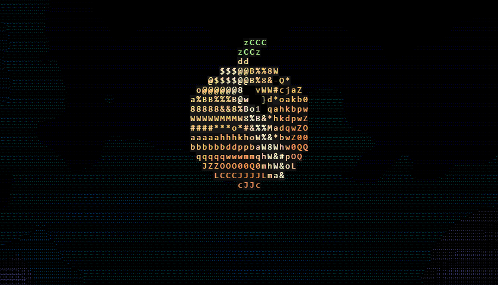
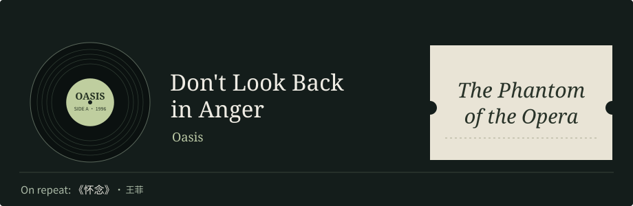
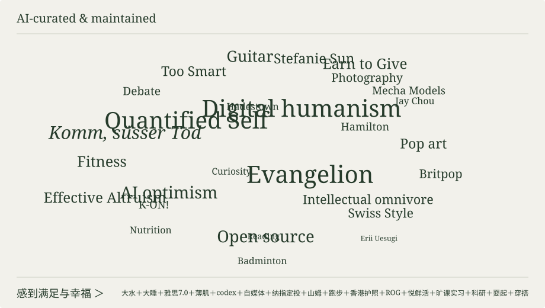

  

# Aurantium🍊

<b>English</b> · <a href="https://github.com/Aurantium-47/Aurantium-47/blob/main/README.zh-CN.md">简体中文</a>

**NLP · AI for Math · Crypto**

[Mathematics](https://github.com/Aurantium-47/aurantium-mathematics) · [Contributions](https://github.com/search?q=author%3AAurantium-47+is%3Apr+is%3Amerged&type=pullrequests)

      

<!-- INTERESTS:START -->

  <picture>
    <source media="(max-width: 640px)" srcset="https://raw.githubusercontent.com/Aurantium-47/Aurantium-47/e13d1db8ba8f6d2d3729db5f9236d573da1c1487/assets/interests/records-mobile.svg?v=20261113">
    
  </picture>

  <picture>
    <source media="(max-width: 640px)" srcset="https://raw.githubusercontent.com/Aurantium-47/Aurantium-47/main/assets/interests/words-mobile.svg?v=20261104">
    
  </picture>

<!-- INTERESTS:END -->

Open source made new things possible for more people.

## Mathematical research

[**Research index · Proofs, counterexamples & extensions**](https://github.com/Aurantium-47/aurantium-mathematics)

**[Two negative answers from the AIM problem list](https://github.com/Aurantium-47/aim23-czds-counterexample)** · 2004 / 2007 · Polynomial zeros

Questions dating back two decades ask whether polynomial transformations preserve properties of their zeros. **AIM 23: a counterexample increases nonreal zeros from 4 to 6. [AIM 34](https://github.com/Aurantium-47/aim34-multiplier-sequence): from asking whether sufficiently large integer parameters work to ruling out every positive real parameter.** Both include Lean sources, historical replay records and independent AI review. [Background: Craven–Csordas](https://math.hawaii.edu/~tom/mathfiles/czdssurvey.pdf) · [Chasse's dissertation](https://math.hawaii.edu/home/talks/thesis.pdf)

**[BRW graph polynomials: progress on a 1994 question](https://github.com/Aurantium-47/brw-tau-clique-attachments/tree/dc6d35ba53c6a41064bc9982cb524b05b74dc2ff/extensions/2026-11-02-uniform-cycle-substitution)** · [Canadian Journal of Mathematics · 1994](https://doi.org/10.4153/CJM-1994-002-3) · Graph theory

When graphs are assembled, which polynomial-zero properties survive? **A uniform result extends particular cycle lengths to every cycle length:** replacing one cycle vertex with a graph satisfying the stated condition preserves the relevant real-rootedness property and permits further attachment along an edge. This covers a whole construction family, as a partial result toward the general conjecture.

**[Stack-sorting: a uniform proof draft for permutation counts](https://github.com/Aurantium-47/aurantium-mathematics/tree/d6c4747db93eb8c7acfcb792215452cc1f2249dc/research/stack-sorting-fibre-log-concavity)** · 2026 · Combinatorics

A proof draft explaining a stronger form of log-concavity in counts of permutations sharing a sorting output. **[This draft's Git commit: November 4](https://github.com/Aurantium-47/aurantium-mathematics/commit/d6c4747db93eb8c7acfcb792215452cc1f2249dc)**; the corresponding conclusion also appears in **[Theorem 1.1 of the November 10 arXiv preprint](https://arxiv.org/html/2611.13479v1#S1.Thmtheorem1)** by Colin Defant (<a href="https://sites.google.com/view/colin-defant/home">Harvard postdoctoral fellow</a>). The proof and literature comparison are public.

AI-assisted research drafts with documented checks, not human-peer-reviewed results. References and dates provide research context, not author endorsement or a priority determination.

**[More mathematical work · Full index & verification materials](https://github.com/Aurantium-47/aurantium-mathematics#全部项目)**

## NLP & information retrieval

**Dense & Hybrid Retrieval · Knowledge Graphs · Retrieval-Augmented QA**

Research interests in retrieval and question answering over text–graph knowledge bases, focusing on **complementary retrieval channels, relation-aware entity disambiguation, and coordination between retrieval and reranking**.

Current work uses **STaRK-MAG** to explore how entity text, attributes and graph relations can jointly guide candidate selection under both semantic and relational constraints.

## Research tools

**[Research-to-Decision](https://github.com/Aurantium-47/Research-to-Decision)** — an agent workflow that turns research into a choice. Built on BMad Deep Recon and OpenInquire’s cross-platform reading, it clarifies requirements, compares evidence and trade-offs, and explains when to choose an alternative.

## Contributions

**Draft engineering · [Sentence Transformers: synchronized per-dataset batches #4317](https://github.com/huggingface/sentence-transformers/pull/4317)**

Align tasks across ranks while allowing task-specific per-rank batch sizes; preserve the training schedule across checkpoint resume. **18 real two-rank CPU/Gloo Trainer runs** (6 configurations × full / prefix / resume) matched native-objective checks and continuous-versus-resumed trajectories in deterministic fixtures.

**Not merged:** depends on the unmerged [Accelerate draft #4491](https://github.com/huggingface/accelerate/pull/4491); upstream CI awaits maintainer approval.

Scheduling diagram, fixed evidence & limits

[Fixed reproduction evidence · 2 November 2026](https://github.com/Aurantium-47/sentence-transformers/tree/f4d3da733194cf46e5cbd8d6014df94f558e769a/research/synchronized-dataset-batches) includes rank traces, source hashes and JSON-only oracle replay. The 18 jobs were run in an independent validation environment, not upstream CI. The diagram illustrates scheduling, not measured throughput. Scope: fixed two-rank CPU/Gloo, ordinary map-style sampling and deterministic resume fixtures; no GPU/NCCL, arbitrary stochastic-resume or performance claim. AI-assisted implementation, tests and evidence review.

Selected merged contributions:

<strong><a href="https://github.com/huggingface/tokenizers">Hugging Face Tokenizers</a></strong> · <a href="https://github.com/huggingface/tokenizers/pull/2567">#2567</a> · merged Fixed <strong>Kimi</strong> pretokenization for overlapping Han, numeric and punctuation categories, preserving regex split semantics across byte-block boundaries; added parity and JSON/BPE encoding regressions.

<strong><a href="https://github.com/HKUDS/LightRAG">LightRAG</a></strong> · <a href="https://github.com/HKUDS/LightRAG/pull/4368">#4368</a> · merged Identified and fixed a PostgreSQL legacy-vector migration defect that treated partial copies as complete, contributing a reproducer, server-side copying and regression tests. The maintainer built on this with resumable segments and cross-instance fencing, and <a href="https://github.com/HKUDS/LightRAG/pull/4368#issuecomment-6828325439">verified 20,000 256-dimensional vectors row by row and duplicate-free migration of 30,000 rows across two instances</a>.

<strong><a href="https://github.com/huggingface/sentence-transformers">Sentence Transformers</a></strong> · <a href="https://github.com/huggingface/sentence-transformers/pull/4251">#4251</a> · <a href="https://github.com/huggingface/sentence-transformers/pull/4262">#4262</a> · <a href="https://github.com/huggingface/sentence-transformers/pull/4264">#4264</a> · <a href="https://github.com/huggingface/sentence-transformers/pull/4284">#4284</a> Sentence embeddings and semantic search. Fixed rescoring for reused floating-point USearch indexes to preserve retrieval ranking. Also merged: honor CrossEncoder rescoring when mining negatives without score filters (#4262); handle empty candidate lists in reranking evaluation (#4264); exclude self-pairs when GIST guide scores tie (#4284).

<strong><a href="https://github.com/morluto/rea">REA</a></strong> · <a href="https://github.com/morluto/rea/pull/2422">#2422</a> · <a href="https://github.com/morluto/rea/pull/2448">#2448</a> · <a href="https://github.com/morluto/rea/pull/2429">#2429</a> An agent-driven reverse-engineering platform. Contributed improvements to cross-platform compatibility and binary diagnostics.

<strong><a href="https://github.com/github/spec-kit">Spec Kit</a></strong> · <a href="https://github.com/github/spec-kit/pull/4956">#4956</a> GitHub’s spec-driven development toolkit. Contributed improvements to Windows workflow reliability.

**More merged contributions**

- **[awesome-python](https://github.com/vinta/awesome-python)**  · [#3376](https://github.com/vinta/awesome-python/pull/3376) · Keyboard navigation
- **[IPython](https://github.com/ipython/ipython)**  · [#15435](https://github.com/ipython/ipython/pull/15435) · Pathlib support
- **[Oh My Zsh](https://github.com/ohmyzsh/ohmyzsh)**  · [#14184](https://github.com/ohmyzsh/ohmyzsh/pull/14184) · uv documentation
- **[KOReader](https://github.com/koreader/koreader)**  · [#16220](https://github.com/koreader/koreader/pull/16220) · Annotation export
- **[JSON5](https://github.com/json5/json5)**  · [#371](https://github.com/json5/json5/pull/371) · Serialization correctness
- **[Xarray](https://github.com/pydata/xarray)**  · [#11711](https://github.com/pydata/xarray/pull/11711) · Windows documentation builds
- **[pydicom](https://github.com/pydicom/pydicom)**  · [#2388](https://github.com/pydicom/pydicom/pull/2388) · Numeric JSON conversion
- **[Developer Roadmap](https://github.com/nilbuild/developer-roadmap)**  · [#10451](https://github.com/nilbuild/developer-roadmap/pull/10451) · Python learning content
- **[Free Programming Books](https://github.com/EbookFoundation/free-programming-books)**  · [#13533](https://github.com/EbookFoundation/free-programming-books/pull/13533) · Contributor navigation

## Selected activity

AI-assisted updates

<!-- ACTIVITY:START -->
- 2026-11-12 · [Tokenizers #2567 — approved by SBrandeis and merged; corrected Kimi pretokenization for overlapping Han categories.](https://github.com/huggingface/tokenizers/pull/2567)
- 2026-10-22 · [Sentence Transformers #4251 — Tom Aarsen clarified precision handling and expanded the regression tests before merging the fix.](https://github.com/huggingface/sentence-transformers/pull/4251#issuecomment-6342707340)
- 2026-10-21 · [IPython #15435 — merged by Carreau.](https://github.com/ipython/ipython/pull/15435)
- 2026-10-20 · [Oh My Zsh #14184 — merged by robbyrussell.](https://github.com/ohmyzsh/ohmyzsh/pull/14184)
- 2026-10-18 · [Xarray #11711 — follow-up thanks from VeckoTheGecko after merge.](https://github.com/pydata/xarray/pull/11711#issuecomment-6249123066)
- 2026-10-17 · [awesome-python #3376 — approved and merged by vinta.](https://github.com/vinta/awesome-python/pull/3376)
- 2026-10-17 · [Xarray #11711 — approved and merged by headtr1ck.](https://github.com/pydata/xarray/pull/11711)
- 2026-10-17 · [Published Aurantium · Mathematics: 24 research projects, including 8 with Lean formalization.](https://github.com/Aurantium-47/aurantium-mathematics)
- 2026-10-15 · [JSON5 #371 — merged.](https://github.com/json5/json5/pull/371)
- 2026-10-14 · [Spec Kit #4956 — merged.](https://github.com/github/spec-kit/pull/4956)
- 2026-10-13 · [REA #2448 — merged; CassieFox23 independently reproduced and verified the fix on Linux.](https://github.com/morluto/rea/pull/2448#issuecomment-6138368698)
- 2026-10-13 · [REA #2422 — merged; N0zoM1z0’s follow-up extension #2635 also merged upstream.](https://github.com/morluto/rea/pull/2635)
- 2026-10-12 · [REA #2227](https://github.com/morluto/rea/pull/2227#issuecomment-6127162628) — maintainer morluto called the contribution “Brilliant”; an [upstream implementation](https://github.com/morluto/rea/commit/c9fed50691ae014890e91a72534773d2fb58ce44) followed.

More activity

- 2026-10-31 · [claude-trading-skills #596](https://github.com/tradermonty/claude-trading-skills/pull/596) — merged a fix aligning reported risk with the selected position-sizing method; maintainer tradermonty’s [follow-up #602](https://github.com/tradermonty/claude-trading-skills/pull/602) added stop validation, Decimal risk rounding and documentation.
- 2026-10-15 · [Developer Roadmap #10451 — merged.](https://github.com/nilbuild/developer-roadmap/pull/10451)
- 2026-10-15 · [Free Programming Books #13533 — merged.](https://github.com/EbookFoundation/free-programming-books/pull/13533)
- 2026-10-15 · [Published the Lean supplement for Hardinian asymptotics at r = 2.](https://github.com/Aurantium-47/hardinian-array-asymptotics/blob/477fcff33df19d5f752f9748d8596b31da15c81b/FORMALIZATION.md)
- 2026-10-14 · [KOReader #16220 — merged.](https://github.com/koreader/koreader/pull/16220)
- 2026-10-14 · [REA #3224 — Kotlin source inventory support adopted upstream with co-author credit.](https://github.com/morluto/rea/commit/03ffb2c13dc6d3e8e0cc8cec70efb2a220c38607)

<!-- ACTIVITY:END -->

[All projects](https://github.com/Aurantium-47?tab=repositories) · [Merged contributions](https://github.com/search?q=author%3AAurantium-47+is%3Apr+is%3Amerged&type=pullrequests)
