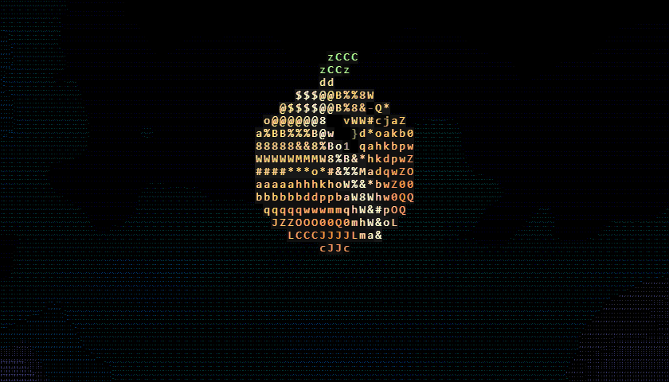
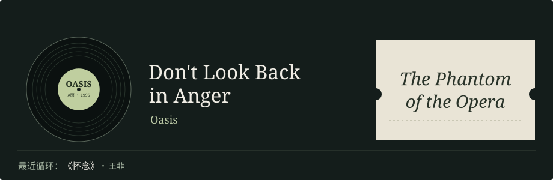

  

# Aurantium🍊

<a href="https://github.com/Aurantium-47">English</a> · <b>简体中文</b>

**NLP · AI for Math · 加密市场**

[数学研究](https://github.com/Aurantium-47/aurantium-mathematics) · [开源贡献](https://github.com/search?q=author%3AAurantium-47+is%3Apr+is%3Amerged&type=pullrequests)

      

<!-- INTERESTS:START -->

  <picture>
    <source media="(max-width: 640px)" srcset="https://raw.githubusercontent.com/Aurantium-47/Aurantium-47/f66fade9b3a78cbb0cde0b1588fad17ff55e3075/assets/interests/records-mobile-zh.svg?v=5">
    
  </picture>

  <picture>
    <source media="(max-width: 640px)" srcset="https://raw.githubusercontent.com/Aurantium-47/Aurantium-47/main/assets/interests/words-mobile-zh.svg?v=20261104">
    
  </picture>

<!-- INTERESTS:END -->

开源，让更多人有了新的可能。

## 数学研究

[**研究目录 · 证明、反例与推广**](https://github.com/Aurantium-47/aurantium-mathematics)

**[Kubitzke–Welker 问题 4.4：覆盖全部 1–13 次情形](https://github.com/Aurantium-47/kubitzke-welker-degree13/tree/11e7139f991497229885d2f1b096949c77265e92)** · [原问题，第 17 页](https://www.mathematik.uni-marburg.de/~welker/preprints/Veronese.pdf#page=17) · 实根多项式 / 单纯复形

**系数大小不设上限。** 对任意仅有实零点、系数为正整数的 h(t)=1+h₁t+⋯+h_dtᵈ，只要 1 ≤ d ≤ 13，每个严格递增初段 1 < h₁ < ⋯ < hᵣ 的差分向量 (1,h₁−1,…,hᵣ−hᵣ₋₁) 都是某个单纯复形的 f 向量。

**证明与范围：** 严格的计算机辅助证明结合穷尽的精确整数枚举与覆盖整个无界尾部的解析论证。**不限制次数的一般问题在本工作中仍未解决。**

**审核与优先权：** AI 生成的数学工作经两组独立开展的 AI 审核，有限计算有三套实现。**尚无人类同行评审或证明助手形式化，创新性与发表优先权未确立。** [来源与声明边界](https://github.com/Aurantium-47/kubitzke-welker-degree13/blob/11e7139f991497229885d2f1b096949c77265e92/PROVENANCE.md)

范围示意、证明与精确证书

- **证明：** [12 次以内的论证](https://github.com/Aurantium-47/kubitzke-welker-degree13/blob/11e7139f991497229885d2f1b096949c77265e92/proofs/degree12_proof.md)与 [13 次扩展](https://github.com/Aurantium-47/kubitzke-welker-degree13/blob/11e7139f991497229885d2f1b096949c77265e92/proofs/degree13_extension.md)得到初始差分的 Kruskal–Katona 结论，不只是 Macaulay 增长，也不是另外的原系数向量问题。
- **[复现材料](https://github.com/Aurantium-47/kubitzke-welker-degree13/blob/11e7139f991497229885d2f1b096949c77265e92/REPRODUCIBILITY.md)：** 66 个指标情形共枚举 10,445,449 个有限 q 值，余下 15 个局部候选元组均由精确代数论证排除；无界尾部已有证明，不是截断搜索。
- **边界：** 单独使用 Newton 不等式可保证到 11 次，12 次有反例；该反例不是实根多项式，因此不反驳原问题 4.4。[原始来源与相近问题区别](https://github.com/Aurantium-47/kubitzke-welker-degree13/blob/11e7139f991497229885d2f1b096949c77265e92/SOURCES.md)

**[Ferroni–McGinnis 单位圆猜想 · 证明候选稿](https://github.com/Aurantium-47/ferroni-mcginnis-unit-circle/tree/d9b2bc10e2c8efef8765542f099ea9432ac45de9)** · [猜想 4.5](https://arxiv.org/html/2202.11808v2#S4.SS2) · 多项式零点

**任意正整数容量向量 → 全部零点落在 |x| = 1 上。** 解析证明稿覆盖所有 n ≥ 1、1 ≤ k ≤ n 的加权排列多项式，包括不等容量；常数多项式没有零点。

**审核与优先权：** 两次独立开展的 AI 审核均未发现数学缺口；目前仍为**未经人类同行评审、未完成形式化验证的证明候选稿**。2026 年 9 月的一条 MathOverflow 评论链接了可能相关的更早解答，但其内容未能读取。**创新性与优先权尚未确定，不作首创声明。** [审核状态](https://github.com/Aurantium-47/ferroni-mcginnis-unit-circle/blob/d9b2bc10e2c8efef8765542f099ea9432ac45de9/docs/REVIEW_STATUS.md) · [来源与更早解答线索](https://github.com/Aurantium-47/ferroni-mcginnis-unit-circle/blob/d9b2bc10e2c8efef8765542f099ea9432ac45de9/docs/SOURCES.md)

证明路线图与可复现检验

- **[证明路线](https://github.com/Aurantium-47/ferroni-mcginnis-unit-circle/blob/d9b2bc10e2c8efef8765542f099ea9432ac45de9/docs/PROOF.md)：** 路径矩阵行列式与 Gauss–Lucas 定理将变换后的零点限制在 (−2,2)，再由经典 Grace–Walsh–Szegő 定理与倒数对称性推广到任意正整数容量。递推、生成函数及经典工具均明确归属前人。
- **[计算检验](https://github.com/Aurantium-47/ferroni-mcginnis-unit-circle/blob/d9b2bc10e2c8efef8765542f099ea9432ac45de9/docs/VERIFICATION.md)：** 附 404 个精确单位圆认证；有限检验与图中算例不代替全参数解析证明。本项目只涉及猜想 4.5，不解决另外的 h* 实根性或交错性猜想。

**正式问题集 · 两项完整否定答案，现已公开源码与复核材料**

- **[AIM 23 / Craven–Csordas（2004）](https://github.com/Aurantium-47/aim23-czds-counterexample/tree/491fc358e101f0028af7ab01e9835c5d8d8218e0)：非实根 4 → 6。** 构造满足原题全部假设的整函数与系数序列，但逐系数变换反而增加非实根，否定原充分性问题；不是仅验证有限参数。
- **[AIM 34（2007）](https://github.com/Aurantium-47/aim34-multiplier-sequence/tree/797fe1cb3d5386acd70f5cdd0ec5ce40c5c79a4e)：所有实数 m > 0，都不成立。** 序列 (n+m)^(√(n+m)) 对每个正实平移均不保持多项式实根性，完整否定“充分大的整数平移能否成立”的问题。

直观示意、Lean验证范围与公开版本

两项完整原始靶标已有 **2026年10月的Lean源码重放与独立AI辅助语义复核记录**；此次公开归档与展示没有重新编译Lean。AIM23的精确4→6来自独立有理/Sturm证书，Lean证明输入至多4、输出恰为6；AIM34证明每个参数存在有限多项式反例，不给统一次数上界。原题来自书章／AIM问题表，**不是四大期刊出处**；不宣称人工同行评审、期刊接受或全球首解。固定仓库版本保留源码、历史证据、复现说明及原题链接失效说明。

**[无限对数凹性：正系数多项式的幂](https://github.com/Aurantium-47/eventual-infinite-log-concavity/tree/68f4c920606ad239fbc3a8195bc0987b790f5905)** · [Medina–Straub · 2014 年 · 猜想 5.2 / 例 5.3](https://arxiv.org/abs/1405.1765v1) · 实根与正性

**同一项目的两个范围，都覆盖全部迭代层。**

- **一般正系数多项式：** 对每个固定 p(x)=Σᵢ₌₀ᵈ cᵢxⁱ，其中每个 cᵢ 都是严格正实数，所有**整数 n ≥ N(p)** 的幂，其系数在全部迭代后均在原支撑内严格为正。同一个 N(p) 覆盖全部迭代层，但不宣称所有 p 共用阈值。这是已有的 **2026 年 10 月 14 日 Theorem B**，于 **11 月 2–3 日**完成独立复核。
- **三项式锐阈值：** 对**每个整数 n ≥ 10**，(1+x+x²)^n 的系数在全部迭代后均非负；这一独立草稿处理例 5.3。两项结果均保持原支撑外为零，不推广到非整数幂或内部零系数。

更强结构、复现材料与复核状态

- **三项式的更强结构：** 对每个整数 n ≥ 4004，第四层迭代多项式有 **2n 个互异负实根**。
- **证明与复现：** [一般定理复核](https://github.com/Aurantium-47/eventual-infinite-log-concavity/blob/77bc8246284556dd92dd2f01499cdd98d16b7104/research/general-positive-polynomial-powers/review-2026-11-02/REVIEW.md)检查解析闭合，并以两条精确路线独立重建全部 2,047 条 Poisson 证书。[三项式文稿、代码与证书](https://github.com/Aurantium-47/eventual-infinite-log-concavity/tree/68f4c920606ad239fbc3a8195bc0987b790f5905/research/trinomial-all-n-ge10)以解析论证覆盖无界范围，有限不变锥证书补齐余项；其 [11 月 2 日复核](https://github.com/Aurantium-47/eventual-infinite-log-concavity/blob/1f9c5ce4cd6c5b2e0fe908f11f0a51d85648591f/research/trinomial-all-n-ge10/review-2026-11-02/REVIEW.md)区分证书重放与包络从头重建。
- **当前状态：** 两项均为经过独立 AI 辅助数学与计算复核的计算机辅助证明草稿。[三项式 PR #2](https://github.com/Aurantium-47/eventual-infinite-log-concavity/pull/2)及[一般定理审计 PR #3](https://github.com/Aurantium-47/eventual-infinite-log-concavity/pull/3)仍为未合并草稿。一般定理审计复核已有定理，不是新增成果或 family；不宣称人工同行评审、形式化验证或历史首创认证。

**[Howroyd 27 集猜想](https://github.com/Aurantium-47/howroyd-27-conjecture)** · [2018 年提出 · 距今 8 年](https://oeis.org/A297557) · 极值图论

**从一个已知分支到全部三个余类。** 补齐 2018 年猜想的剩余两类，完成计数公式，并进一步给出 **全部 27 个最大独立集的分类**；剩余分支定理已用 Lean 4 形式化。

原文出处与证明方法

- **原问题出处:** Andrew Howroyd，[OEIS A297557（2018）](https://oeis.org/A297557)。
- **已有进展:** [John Machacek](https://arxiv.org/abs/2010.11112v2) 在 *Procedia Computer Science* 195（2021）证明 3 ∣ d 分支。两项结果合起来补全 d ≥ 9 的计数公式。
- **证明方法:** 以精确加权覆盖证书和坐标归约，将分类化为 3 种背景、每种 9 个角部延拓。
- **补充结果与材料:** 从猜想要求的计数，推进到全部 27 个最大独立集的显式分类。
- **验证方式:** Lean 4 覆盖完整的 d ≥ 10、3 ∤ d 命题；另提供 89 项有理数证书。

**[Lecture Hall：多项式性与代数推广](https://github.com/Aurantium-47/lecture-hall-polynomiality)** · [2018 年提出 · 距今 8 年](https://arxiv.org/abs/1809.01377) · 代数组合 / 交换代数

**从长度 12 的计算验证到任意长度的证明。** 进一步得到系数公式、SAGBI 基与 toric 退化等结构定理；多项式性与路径识别核心已用 Lean 形式化。

原文出处与证明方法

- **原问题出处:** Lukas Katthän，[The Lecture Hall Cone as a toric deformation（2018）](https://arxiv.org/abs/1809.01377)，为大阪格点多面体研讨会准备的论文。
- **已有进展:** 原文提出多项式性与代数结构猜想，并验证长度不超过 12 的情形。Flajolet 的连分数理论与 Sokal 的系统论述提供已有的经典工具。
- **证明方法:** 以带符号 Dyck 路径识别、Toeplitz–Hankel 恒等式和原递推，证明全下标多项式性。
- **补充结果与材料:** 给出组合系数公式、精确单项式计数、最小单首 SAGBI 基、Hilbert 基对应，以及对任意域成立的平坦 toric 退化；使用文稿已披露的方阵子式解释。
- **验证方式:** Lean 覆盖真正有理函数序列的多项式性与带符号路径核心；SAGBI 与退化推广以文字证明给出。

**[BRW τ-实性团粘合：统一圈替换与结构类](https://github.com/Aurantium-47/brw-tau-clique-attachments)** · [Brenti–Royle–Wagner · 1994 年](https://doi.org/10.4153/CJM-1994-002-3) · 图多项式

**覆盖所有圈长的统一替换定理。** 将任意圈的一个顶点替换为任意普通 τ-实图，仍保持 τ-实性，并得到实根 Bell 边商，因此可与任意 τ-实图沿边粘合。连同带锚点不可比图及全部 a,b,c ≥ 2 的 Θ(a,b,c)，这些仍是一般猜想 6.5 的部分结果。

原文出处、定理范围与验证

- **原问题出处:** Francesco Brenti、Gordon F. Royle、David G. Wagner，*Canadian Journal of Mathematics*（1994），猜想 6.5。图联接断言属于另一个猜想 6.6。
- **结构定理:** 不可比图分为 k 个非空独立类，每类有一个与该类之外所有顶点相邻的锚点，则所有团大小 0 ≤ j ≤ k 对应的 Bell 色多项式商均只有实根。因此，它与任意 τ-实图沿任意团进行普通粘合，均保持 τ-实性；涵盖含边的连通 Ferrers 图／链图。
- **完整 theta 图族:** 对所有 a,b,c ≥ 2，Θ(a,b,c) 的 Bell 边商均只有严格负实根，因此与任意 τ-实图沿边普通粘合均保持 τ-实性。以有效根半径界和 Bernstein 判别式证书覆盖解析范围，再用精确有理数根证书补齐全部 2,460 个剩余非降序路径长度三元组；独立整数算术复核覆盖 83,842 个根区间。
- **统一圈替换:** [已发布证明版本](https://github.com/Aurantium-47/brw-tau-clique-attachments/tree/dc6d35ba53c6a41064bc9982cb524b05b74dc2ff/extensions/2026-11-02-uniform-cycle-substitution)。以根的单调性和扩充箭头矩阵不变量作普通数学证明，覆盖所有圈长及输入次数；具有互异严格负实根的输入给出严格交错，非零边界输入给出弱交错。C₅/C₇ 及由 k 条长度为 2 的路径和一条长度为 m 的路径组成的特例被包含，但独立的全三路径定理及任意路径数的长最短路径条件不被替代。不宣称任意同时图替换或不受限的大团粘合。
- **证明与检查:** [结构定理文稿](https://github.com/Aurantium-47/brw-tau-clique-attachments/tree/main/extensions/2026-11-02)、[完整 theta 证明与证书](https://github.com/Aurantium-47/brw-tau-clique-attachments/tree/cfa1f5fd798116b44ddc95da6f90710e48fac14a/extensions/2026-11-02-all-theta)，以及先前的[统一充分大参数补充证明](https://github.com/Aurantium-47/brw-tau-clique-attachments/tree/main/extensions/2026-11-02-uniform-theta)。theta 结果是解析定理与有限余项穷尽精确认证相结合的计算机辅助证明，并非仅凭有限抽样。研究使用 AI 辅助，统一证明经过独立 AI 内部复核；不宣称人工同行评审、证明助手形式化验证或历史首创，文献比较尚不完整。

**[精确证书工程 · 同一冻结任务提速 20.34–20.45 倍](https://github.com/Aurantium-47/eventual-infinite-log-concavity/tree/7af226f3e313472b655a9be9c9d04dd5f6ff8d15/benchmarks/exact-convolution/repeat-results/2026-11-02)** · 将 python-flint 0.9.0 的截断整数卷积集成到精确证书工具中。同一冻结的 node-200 任务经三轮交替顺序配对测试，耗时 14.09–14.81 秒，对照实现为 287.72–301.24 秒；六次运行的全部 361 个整数中点、公共半径与参数及 21 项非性能字段均精确一致。这是共享云环境中特定任务的实测；精确算术后端由 FLINT 提供。

另外两项：10 年前的峰多项式猜想 · K₆ 链的全族锐界

**[峰多项式的最后实根](https://github.com/Aurantium-47/peak-polynomial-last-real-root)** · [Experimental Mathematics · 2016 年期刊版 · 距今 10 年](https://arxiv.org/abs/1410.8506v2) · 多项式实根

**从局部区间结果到完整的最后实根结论。** 通过积分符号分析补足非整数区间的论证，不限制峰的数量与间隔。

- **原问题出处:** Sara Billey、Matthew Fahrbach、Alan Talmage，[*Experimental Mathematics* 25(2), 165–175（2016）](https://arxiv.org/abs/1410.8506v2)；预印本首发于 2014 年。
- **已有进展:** Billey–Fahrbach–Talmage 给出递推与对称恒等式。[Li 的系数定理](https://doi.org/10.5281/zenodo.22832569) 已涵盖右侧正性和若干局部符号性质；本项补足剩余非整数区间的分析。
- **证明方法:** 通过自包含的积分表示与符号分析，覆盖倒数第二峰之后的整个区间。
- **补充结果与材料:** 同时给出最大峰两侧的符号、根的单性和单峰情形；与 Li 定理重叠的推论在文稿中注明归属。
- **验证方式:** 全参数数学证明；附精确有限检查及单独记录的小规模复现。

**[K₆ 链：否定 22 色猜想，并给出全族锐界 23](https://github.com/Aurantium-47/k6-clique-chain-packing-coloring)** · [2025 年提出](https://arxiv.org/abs/2511.12761) · 图着色

**从 22 色猜想到正确的全族锐界 23。** 以 **450 顶点**反例否定原上界，再给出 **整个家族** 的锐界定理，附 **1664 万余条**精确证书记录。

- **原问题出处:** Furmańczyk、Gözüpek、Özkan，[Packing coloring of graphs with long paths（2025）](https://arxiv.org/abs/2511.12761)，猜想 2。
- **已有进展:** 原文为沿路径连接的 K₆ 团链提出统一 22 色上界。
- **证明方法:** 以有限状态调度松弛和递减秩证书排除 22 色，再构造显式周期着色得到 23 色上界。
- **补充结果与材料:** 建立全族锐界 23，并证明所有 t ≥ 75 的精确值均为 23；尚未确定最短反例长度和所有较短链的精确值。
- **验证方式:** 16,646,562 条精确证书，由 Python 与 C++ 检查器核验；属于计算证书核验，并非 Lean 形式化。

**[更多数学工作](https://github.com/Aurantium-47/aurantium-mathematics#全部项目)**

## NLP 与信息检索

**Dense & Hybrid Retrieval · Knowledge Graphs · Retrieval-Augmented QA**

研究文本与图关系共同约束下的检索与问答，重点是**多路召回的互补、关系约束下的实体消歧，以及召回与重排的协同**。

当前以 **STaRK-MAG** 为主要场景，探索如何联合实体文本、属性和图关系，让候选选择同时满足语义与关系条件。

## 调研工具

**[Research-to-Decision](https://github.com/Aurantium-47/Research-to-Decision)** — 从调研到抉择的 Agent 工作流。基于 BMad Deep Recon 和 OpenInquire 的跨平台读取，主动澄清需求、核对证据与实际利弊，给出首选、代价和改选条件。

## 开源贡献

**工程草稿 · [Sentence Transformers：按数据集同步批次 #4317](https://github.com/huggingface/sentence-transformers/pull/4317)**

让各 rank 在同一步处理同一任务，同时保留按任务配置的单 rank 批大小，并在 checkpoint 恢复后保持训练调度。**18 次真实双 rank CPU/Gloo Trainer 运行**（6 组配置 × 完整 / 前缀 / 恢复）通过原生目标检查，确定性测试中恢复后的轨迹与连续训练一致。

**尚未合并：** 依赖同样未合并的 [Accelerate 草稿 #4491](https://github.com/huggingface/accelerate/pull/4491)；上游 CI 等待维护者批准运行。

调度示意图、固定复现证据与边界

[固定复现材料 · 2026 年 11 月 2 日](https://github.com/Aurantium-47/sentence-transformers/tree/f4d3da733194cf46e5cbd8d6014df94f558e769a/research/synchronized-dataset-batches)包含 rank 轨迹、源文件哈希及纯 JSON 数值核对。18 次运行来自独立验证环境，不是上游 CI；图示说明调度，不代表吞吐测量。范围限于固定双 rank CPU/Gloo、普通 map-style 采样及确定性恢复测试，不宣称 GPU/NCCL、任意随机恢复或性能收益。实现、测试和证据复核使用 AI 辅助。

部分已合并的上游贡献：

<strong><a href="https://github.com/huggingface/sentence-transformers">Sentence Transformers</a></strong> · <a href="https://github.com/huggingface/sentence-transformers/pull/4251">#4251</a> 句向量与语义检索。修复复用浮点 USearch 索引时的重排判断，避免浮点向量被截断后破坏检索排序。

<strong><a href="https://github.com/morluto/rea">REA</a></strong> · <a href="https://github.com/morluto/rea/pull/2422">#2422</a> · <a href="https://github.com/morluto/rea/pull/2448">#2448</a> · <a href="https://github.com/morluto/rea/pull/2429">#2429</a> 面向智能体的逆向工程平台。贡献涉及跨平台兼容性与二进制诊断。

<strong><a href="https://github.com/vinta/awesome-python">awesome-python</a></strong> · <a href="https://github.com/vinta/awesome-python/pull/3376">#3376</a> Python 资源精选。贡献涉及网站无障碍与交互导航。

<strong><a href="https://github.com/github/spec-kit">Spec Kit</a></strong> · <a href="https://github.com/github/spec-kit/pull/4956">#4956</a> GitHub 官方规范驱动开发工具包。贡献涉及 Windows 工作流可靠性。

<strong><a href="https://github.com/ipython/ipython">IPython</a></strong> · <a href="https://github.com/ipython/ipython/pull/15435">#15435</a> 交互式 Python 与 Jupyter 工具链。修复 <code>FileLinks(Path(...))</code> 对 pathlib 目录路径的支持。

<strong><a href="https://github.com/ohmyzsh/ohmyzsh">Oh My Zsh</a></strong> · <a href="https://github.com/ohmyzsh/ohmyzsh/pull/14184">#14184</a> Zsh 配置框架。纠正 uv 初始化别名说明，区分独立项目与父工作区成员。

<strong><a href="https://github.com/koreader/koreader">KOReader</a></strong> · <a href="https://github.com/koreader/koreader/pull/16220">#16220</a> 面向电子墨水设备与 Android 的文档阅读器。贡献涉及批注工作流。

<strong><a href="https://github.com/json5/json5">JSON5</a></strong> · <a href="https://github.com/json5/json5/pull/371">#371</a> JSON5 的 JavaScript 实现。贡献涉及序列化正确性。

<strong><a href="https://github.com/pydata/xarray">Xarray</a></strong> · <a href="https://github.com/pydata/xarray/pull/11711">#11711</a> 面向科学计算的带标签数组库。贡献涉及文档工作流可靠性。

<strong><a href="https://github.com/pydicom/pydicom">pydicom</a></strong> · <a href="https://github.com/pydicom/pydicom/pull/2388">#2388</a> 处理 DICOM 医学影像的 Python 库。贡献涉及数据转换与互操作性。

<strong><a href="https://github.com/nilbuild/developer-roadmap">Developer Roadmap</a></strong> · <a href="https://github.com/nilbuild/developer-roadmap/pull/10451">#10451</a> 开发者学习路线与技术指南。贡献涉及 Python 学习内容。

<strong><a href="https://github.com/EbookFoundation/free-programming-books">Free Programming Books</a></strong> · <a href="https://github.com/EbookFoundation/free-programming-books/pull/13533">#13533</a> 多语言免费编程资源库。参与完善贡献者文档。

Stars 快照 · 2026-10-17–18

## 动态精选

AI 辅助维护

<!-- ACTIVITY:START -->
- 2026-10-22 · [Sentence Transformers #4251 — Tom Aarsen 补充了精度参数说明和回归测试，并合并修复。](https://github.com/huggingface/sentence-transformers/pull/4251#issuecomment-6342707340)
- 2026-10-21 · [IPython #15435 由 Carreau 合并。](https://github.com/ipython/ipython/pull/15435)
- 2026-10-20 · [Oh My Zsh #14184 由 robbyrussell 合并。](https://github.com/ohmyzsh/ohmyzsh/pull/14184)
- 2026-10-18 · [Xarray #11711 合并后，收到 VeckoTheGecko 的后续致谢。](https://github.com/pydata/xarray/pull/11711#issuecomment-6249123066)
- 2026-10-17 · [awesome-python #3376 获 vinta 批准并合并。](https://github.com/vinta/awesome-python/pull/3376)
- 2026-10-17 · [Xarray #11711 获 headtr1ck 批准并合并。](https://github.com/pydata/xarray/pull/11711)
- 2026-10-17 · [发布 Aurantium · Mathematics，汇总 24 个数学研究项目，其中 8 项包含 Lean 形式化。](https://github.com/Aurantium-47/aurantium-mathematics)
- 2026-10-15 · [JSON5 #371 已合并。](https://github.com/json5/json5/pull/371)
- 2026-10-14 · [Spec Kit #4956 已合并。](https://github.com/github/spec-kit/pull/4956)
- 2026-10-13 · [REA #2448 已合并；CassieFox23 在 Linux 上独立复现并确认修复有效。](https://github.com/morluto/rea/pull/2448#issuecomment-6138368698)
- 2026-10-13 · [REA #2422 已合并；N0zoM1z0 接续完成扩展 #2635，亦已并入上游。](https://github.com/morluto/rea/pull/2635)
- 2026-10-12 · [REA #2227](https://github.com/morluto/rea/pull/2227#issuecomment-6127162628) 的方案获维护者 morluto 评价「Brilliant」，并有[上游实现](https://github.com/morluto/rea/commit/c9fed50691ae014890e91a72534773d2fb58ce44)跟进。

更多动态

- 2026-10-31 · [claude-trading-skills #596](https://github.com/tradermonty/claude-trading-skills/pull/596) 已合并，使报告风险与实际采用的仓位计算方法一致；维护者 tradermonty 的[后续 #602](https://github.com/tradermonty/claude-trading-skills/pull/602) 补充止损校验、Decimal 风险舍入与文档。
- 2026-10-15 · [Developer Roadmap #10451 已合并。](https://github.com/nilbuild/developer-roadmap/pull/10451)
- 2026-10-15 · [Free Programming Books #13533 已合并。](https://github.com/EbookFoundation/free-programming-books/pull/13533)
- 2026-10-15 · [发布 Hardinian 渐近式 r = 2 的 Lean 补充证明。](https://github.com/Aurantium-47/hardinian-array-asymptotics/blob/477fcff33df19d5f752f9748d8596b31da15c81b/FORMALIZATION.md)
- 2026-10-14 · [KOReader #16220 已合并。](https://github.com/koreader/koreader/pull/16220)
- 2026-10-14 · [REA #3224 — Kotlin 源文件识别支持获上游采纳，并保留共同作者署名。](https://github.com/morluto/rea/commit/03ffb2c13dc6d3e8e0cc8cec70efb2a220c38607)

<!-- ACTIVITY:END -->

[全部项目](https://github.com/Aurantium-47?tab=repositories) · [已合并贡献](https://github.com/search?q=author%3AAurantium-47+is%3Apr+is%3Amerged&type=pullrequests)
